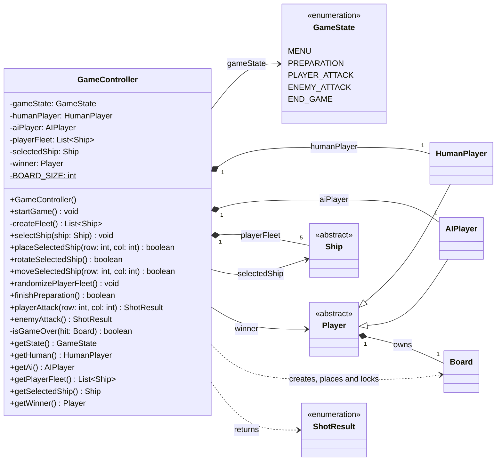

# Battleship - Class Diagram (controller)

## How to read it

- Attributes: `visibility name: Type`. Methods: `visibility name(param: Type) ReturnType`.
- Visibility: `-` private, `+` public. `createFleet` and `isGameOver` are private helpers.
- `BOARD_SIZE` is a constant (`static final`, underlined): the board is always 10x10.
- Filled diamond = composition (the controller creates and owns the part). The numbers say how many: one `HumanPlayer`, one `AIPlayer`, five `Ship` in `playerFleet`.
- `selectedShip` is only a reference to one ship of the fleet, so it is a plain association.
- `winner` is a `Player`, so it can hold a `HumanPlayer` or an `AIPlayer` (inheritance).
- Model classes appear without members to keep the diagram readable; their details are in `modelUML.md`.

## State flow

| From | Event | To |
|---|---|---|
| `MENU` | `startGame()` | `PREPARATION` |
| `PREPARATION` | `finishPreparation()` with all ships placed | `PLAYER_ATTACK` |
| `PLAYER_ATTACK` | `MISS` | `ENEMY_ATTACK` |
| `PLAYER_ATTACK` | `HIT` or `SUNK` (ships left) | `PLAYER_ATTACK` |
| `PLAYER_ATTACK` | `SUNK` on the last ship | `END_GAME` |
| `ENEMY_ATTACK` | `MISS` | `PLAYER_ATTACK` |
| `ENEMY_ATTACK` | `HIT` or `SUNK` (ships left) | `ENEMY_ATTACK` |
| `ENEMY_ATTACK` | `SUNK` on the last ship | `END_GAME` |
| `END_GAME` | `startGame()` (play again) | `PREPARATION` |

An `INVALID` shot changes nothing.

## Notes

- The controller imports nothing from `javafx`. The view calls one method per click and reads the result and the getters to redraw.
- Every action method starts with a guard: if the state is not the required one, it does nothing and returns `false` or `INVALID`.
- `startGame()` already places the player's fleet at random, so preparation starts with a valid board.
- `randomizePlayerFleet()` removes every ship and places the fleet again, so it can be called many times.
- `enemyAttack()` fires one shot per call. After a hit the state stays `ENEMY_ATTACK` and the view calls it again, with a pause.

## Changes since the previous version

- Added `moveSelectedShip` and the private `createFleet`.
- Attribute and getter names now match the code (`gameState`, `humanPlayer`, `aiPlayer`).
- Added the `BOARD_SIZE` constant and the `selectedShip` association.
