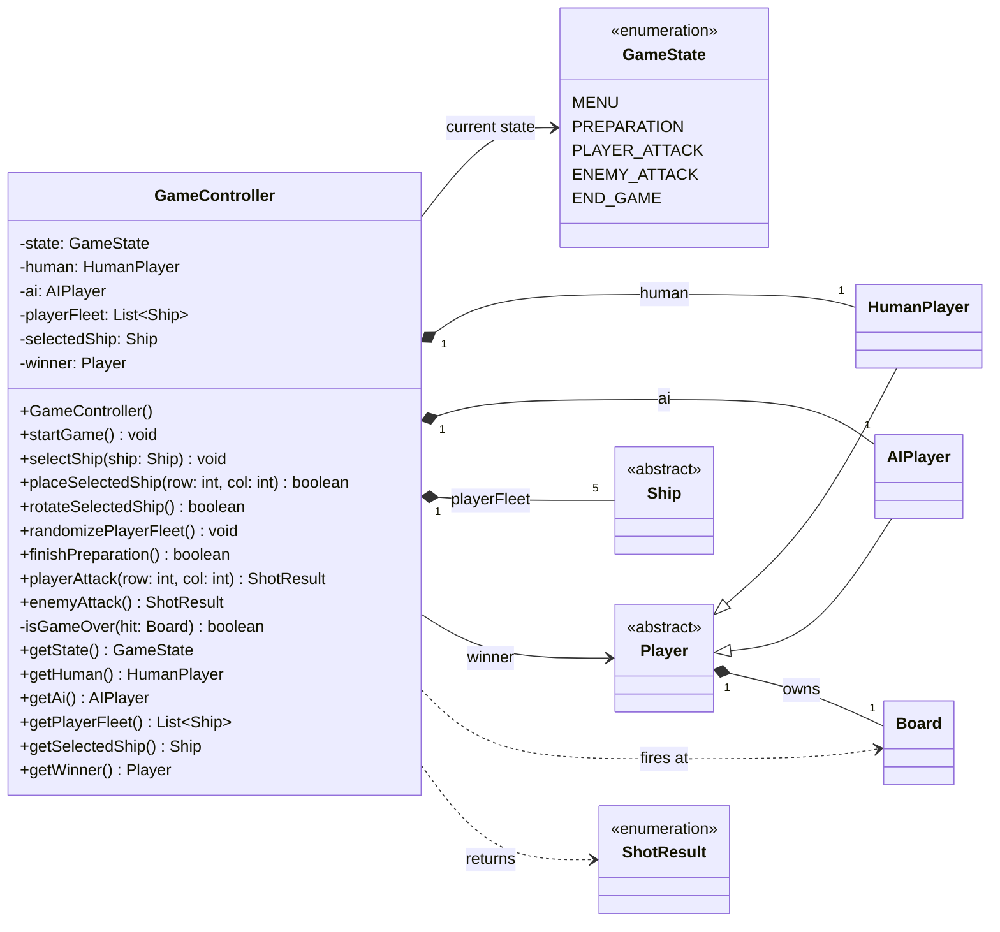

# Battleship - Class Diagram (controller)

Rendered automatically by GitHub. To export an image for the PDF, use `controllerUML.png` or paste the code block into https://mermaid.live.

## How to read it

- Attributes: `visibility name: Type`. Methods: `visibility name(param: Type) ReturnType`.
- Visibility: `-` private, `+` public. `isGameOver` is private: only `playerAttack` and `enemyAttack` call it.
- Filled diamond = composition (the controller creates and owns the part). The numbers are how many parts: one `HumanPlayer`, one `AIPlayer`, five `Ship` in `playerFleet`.
- Dashed arrow = uses (`fires at` a `Board`, `returns` a `ShotResult`).
- `winner` is a `Player`, so it can hold either a `HumanPlayer` or an `AIPlayer` (inheritance).
- Model classes appear without members to keep the diagram readable; their details are in `modelUML.md`.

## State flow

| From | Event | To |
|---|---|---|
| `MENU` | start game | `PREPARATION` |
| `PREPARATION` | all ships placed, battle starts | `PLAYER_ATTACK` |
| `PLAYER_ATTACK` | `MISS` | `ENEMY_ATTACK` |
| `PLAYER_ATTACK` | `HIT` or `SUNK` (ships left) | `PLAYER_ATTACK` |
| `PLAYER_ATTACK` | `SUNK` on the last ship | `END_GAME` |
| `ENEMY_ATTACK` | `MISS` | `PLAYER_ATTACK` |
| `ENEMY_ATTACK` | `HIT` or `SUNK` (ships left) | `ENEMY_ATTACK` |
| `ENEMY_ATTACK` | `SUNK` on the last ship | `END_GAME` |
| `END_GAME` | play again or back to menu | `PREPARATION` / `MENU` |

An `INVALID` shot changes nothing.

## Notes

- The controller imports nothing from `javafx`. The view calls one method per click and reads the result and the getters to redraw.
- Every action method starts with a guard: if the state is not the required one, it does nothing.