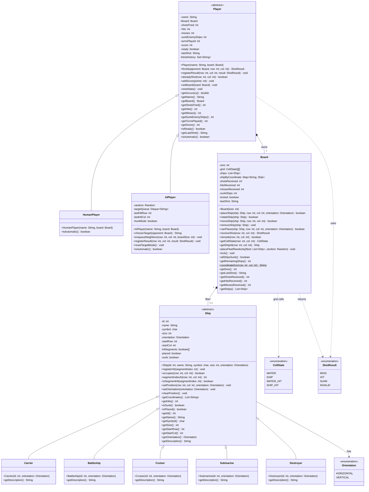

# Battleship - Class Diagram (model)

## How to read it

- Attributes: `visibility name: Type`. Methods: `visibility name(param: Type) ReturnType`.
- Visibility: `-` private, `+` public, `#` protected.
- `<<abstract>>` above the name = abstract class. A method in *italic* is abstract (`getDescription`, `isAutomatic`). A method underlined is static (`coordinateKey`).
- Hollow triangle arrow = inheritance (`extends`). Filled diamond = composition (the whole owns the part). Dashed arrow = uses.
- Ship sizes: Carrier 5, Battleship 4, Cruiser 3, Submarine 3, Destroyer 2.
- `shipByCoordinate` (Map) links keys like `"B3"` to the `Ship` occupying that cell.
- All public methods are listed, including the simple getters.
- `Ship.getCoordinates()` and `Player` also call the static `Board.coordinateKey(...)`. Those arrows were left out to keep the diagram readable.

## Changes since the previous version

- `Board`: added `moveShip` and the getters used by the view and the controller. `canPlace` now ignores the ship's own cells.
- `Ship`: added `clearPosition`, `isPlaced` and the getters for id, name, symbol, size and position.
- `Player`: added the statistics getters and the private `resetStats`.
- Fleet multiplicity in `Board` is `0..5`, because ships are added and removed during preparation.
