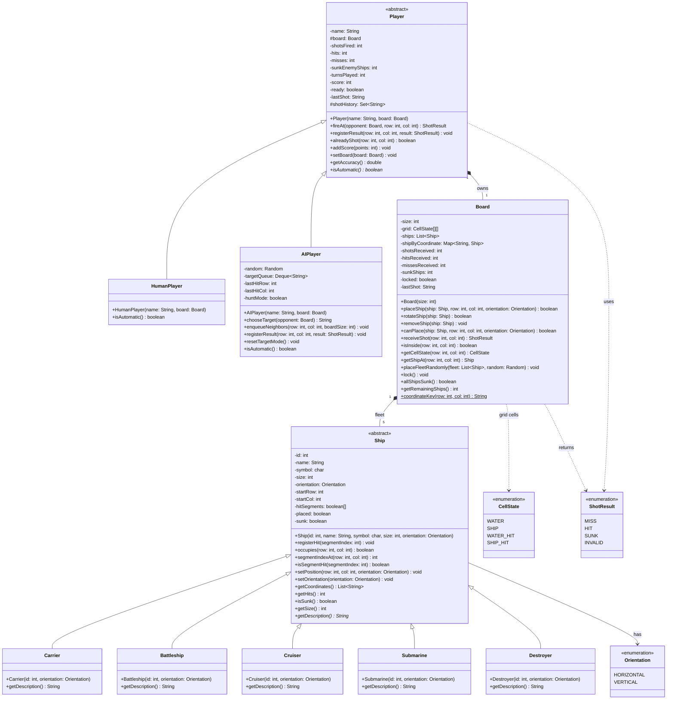

# Battleship - Class Diagram (model)

## How to read it

- Attributes: `visibility name: Type`. Methods: `visibility name(param: Type) ReturnType` (the renderer shows `: ReturnType`).
- Visibility: `-` private, `+` public, `#` protected.
- `<<abstract>>` above the name = abstract class. A method in *italic* is abstract (`getDescription`, `isAutomatic`). A method underlined is static (`coordinateKey`).
- Hollow triangle arrow = inheritance (`extends`). Filled diamond = composition (the whole owns the part).
- Ship sizes: Carrier 5, Battleship 4, Cruiser 3, Submarine 3, Destroyer 2.
- `shipByCoordinate` (Map) links keys like `"B3"` to the `Ship` occupying that cell.
- Getters/setters that only return or assign a field are omitted for readability.
- This diagram covers only the `model` package.