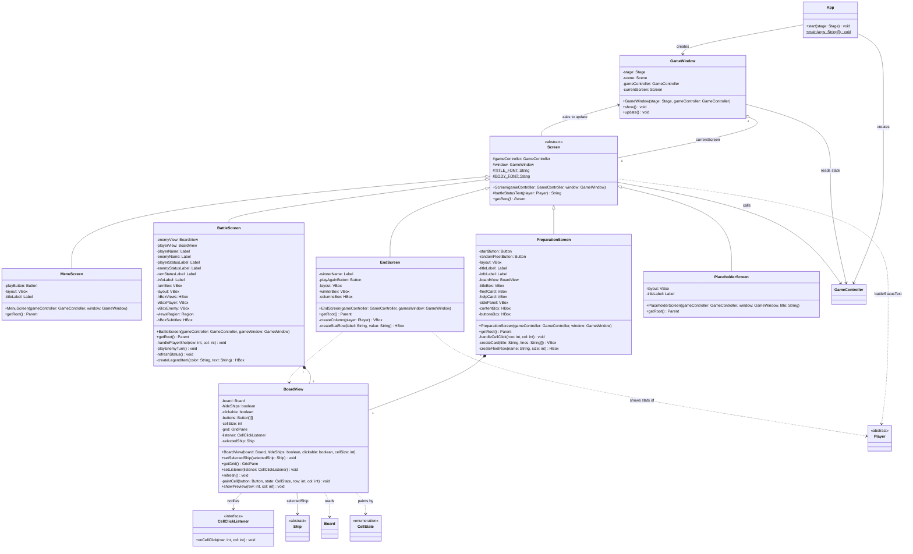

# Battleship - Class Diagram (view)

## How to read it

- `<<abstract>>` = abstract class. `getRoot()` is abstract (marked with `*`): each screen builds its own layout.
- `<<interface>>` = contract. `BoardView` tells whoever listens that a cell was clicked, without knowing who listens.
- Hollow triangle = inheritance. Filled diamond = composition. Hollow diamond = aggregation. Dashed arrow = uses.
- Methods marked with `$` are static, as are the font constants (`TITLE_FONT`, `BODY_FONT`).
- JavaFX types (`Stage`, `Scene`, `Button`, `Label`, `VBox`, `HBox`, `Region`, `GridPane`, `Parent`) appear only as attribute and parameter types.
- `PlaceholderScreen` is not used by the game anymore (it was the first test screen). It can be deleted.

## Screen for each state

| `GameState` | Screen |
|---|---|
| `MENU` | `MenuScreen` |
| `PREPARATION` | `PreparationScreen` |
| `PLAYER_ATTACK`, `ENEMY_ATTACK` | `BattleScreen` |
| `END_GAME` | `EndScreen` |

`GameWindow.update()` reads `gameController.getState()` and shows the matching screen, always on the same `Scene` (`scene.setRoot`). After an action that changes the state, a screen calls `window.update()`.

## What each screen shows

| Screen | Content |
|---|---|
| `MenuScreen` | Game title and the play button |
| `PreparationScreen` | Title banner, own board, fleet card (names and sizes), help card, buttons to shuffle and start |
| `BattleScreen` | Turn banner, both boards with a separator bar, status of each player, color legend |
| `EndScreen` | Winner banner, one column per player (stats and small final board), play again button |

## Notes

- The view never decides rules. It calls one controller method per click and redraws from the model.
- The enemy board is created with `hideShips = true`: cells with `SHIP` are drawn like water.
- `cellSize` sets the size of each cell, so the same `BoardView` is used in three sizes: 54 (preparation), 42 (battle) and 28 (end screen).
- `BoardView.refresh()` repaints every cell. `showPreview` adds a green or red border to the cells the selected ship would occupy.
- Enemy shots are called by `BattleScreen`, one per call, with a 0.8 s pause (`PauseTransition`) between them.
- Fonts: `TITLE_FONT` is used on titles and `BODY_FONT` on the rest. Each screen sets `BODY_FONT` on its root layout and the children inherit it.
- The helper methods `createCard`, `createFleetRow`, `createLegendItem`, `createColumn` and `createStatRow` only build pieces of layout; none of them touches the game rules.

## Changes since the previous version

- `BoardView`: new parameter and attribute `cellSize`; row (1-10) and column (A-J) labels around the grid; sunk ships get a distinct color.
- `Screen`: new constants `TITLE_FONT` and `BODY_FONT`; `statusText` was removed (the end screen now reads each stat directly); `battleStatusText` is the short version used in battle.
- `PreparationScreen`: new layout with title banner, fleet card, help card and bottom buttons (`createCard`, `createFleetRow`).
- `BattleScreen`: turn banner (`turnStatusLabel`, `infoLabel`, `turnBox`), separator bar (`viewsRegion`), color legend (`hBoxSubtitles`, `createLegendItem`).
- `MenuScreen`: game title and larger play button.
- `EndScreen`: winner banner and two stat columns with small boards (`createColumn`, `createStatRow`).
