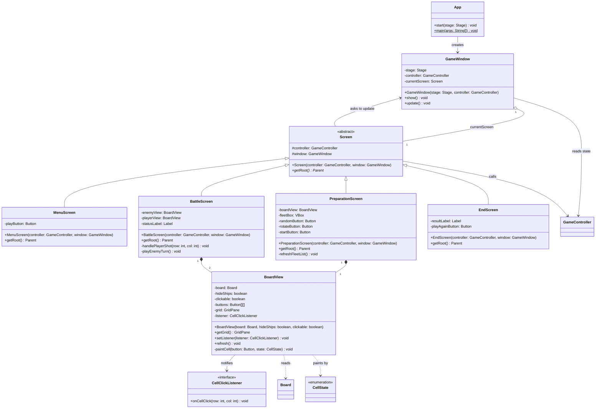

# Battleship - Class Diagram (view)

Rendered automatically by GitHub. To export an image for the PDF, use `viewUML.png` or paste the code block into https://mermaid.live.

## How to read it

- `<<abstract>>` = abstract class. `getRoot()` is abstract (marked with `*`): each screen builds its own layout.
- `<<interface>>` = contract. `BoardView` tells whoever listens that a cell was clicked, without knowing who listens.
- Hollow triangle = inheritance. Filled diamond = composition. Hollow diamond = aggregation. Dashed arrow = uses.

## Screen for each state

| `GameState` | Screen |
|---|---|
| `MENU` | `MenuScreen` |
| `PREPARATION` | `PreparationScreen` |
| `PLAYER_ATTACK`, `ENEMY_ATTACK` | `BattleScreen` |
| `END_GAME` | `EndScreen` |

`GameWindow.update()` reads `controller.getState()` and shows the matching screen. After any action, a screen calls `window.update()`.

## Notes

- The view never decides rules. It calls one controller method per click and redraws from the model.
- The enemy board is created with `hideShips = true`: cells with `SHIP` are drawn like water.
- The enemy shots (`enemyAttack`) are called by `BattleScreen`, one per call, with a short pause between them.